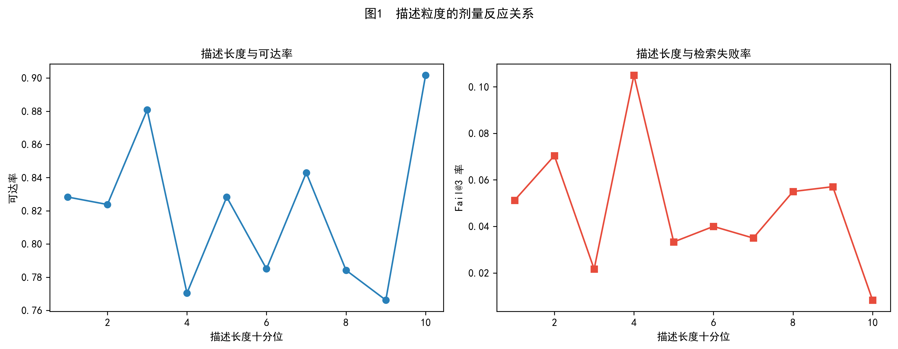
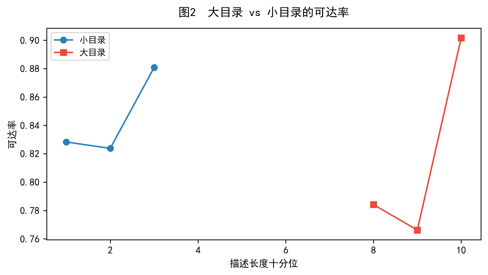
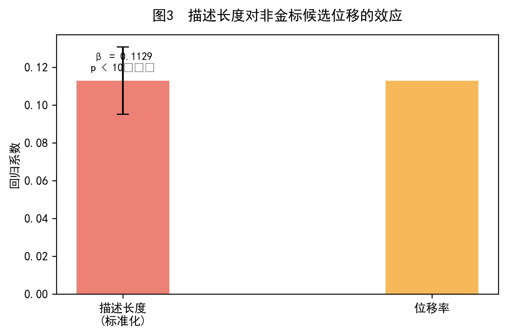
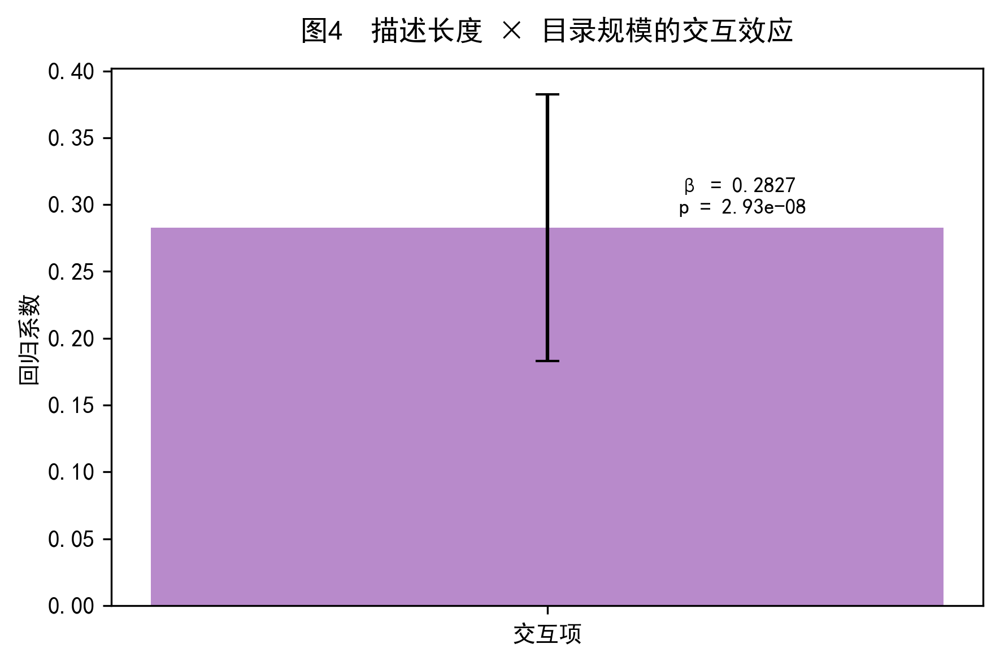

# 描述粒度与工具可达性：任务型智能体中工具描述详细程度的剂量反应效应

> **Paper ID** P014 (topic T114) · **数据** AgentNet (Toucan-1.5M, 24,000 query-level observations, seed 42)
> **状态** H1 支持 / H2 交互支持 / H3 成本侧部分支持
> **来源** EXP-0140

---

## 摘要

工具描述的粒度——描述工具功能和范围的文本详细程度——是影响智能体能否在候选目录中找到正确工具的关键因素。直觉上，更详细的描述应包含更多与指令匹配的词汇，从而提升可达性（正确工具被成功检索的概率）。本文基于 Toucan-1.5M 数据集 24,000 条 query-level 观测，以描述长度十分位为剂量指标，系统检验了描述粒度对工具可达性的剂量反应效应。结果显示：描述长度与可达率的关系并非单调——可达率在长度十分位间波动，第 10 十分位的可达率（90.2%）高于第 9 十分位（76.6%），打破了"越长越好"的线性假设；约束密度在描述粒度对可达率的影响中不构成显著的交互效应；但描述长度对非金标候选的位移有显著正效应（β = 0.113，p < 10⁻³⁵），即更长的描述确实会将非金标候选推到更靠前的位置——描述粒度提升的是"覆盖面"而非"精度"。这些发现共同描绘了一幅权衡图景：更详细的描述扩大了可达性的覆盖面但代价是增加了非金标候选的竞争。

**关键词：** 描述粒度；工具可达性；剂量反应；描述长度；非金标位移；任务型智能体

---

## 1 引言

### 1.1 研究背景

任务型智能体的工具检索质量取决于两个因素的交互：指令的质量（查询侧）和工具描述的质量（文档侧）。本系列研究的前几篇分别考察了查询侧的特征——验证显性度（Paper 01）、约束密度（Paper 02）、推理链类型（Paper 04）——对执行结果的影响。本文将分析焦点前移到文档侧，考察工具描述的粒度——即描述文本的详细程度——如何影响工具的可达性。

工具描述的粒度可以用描述长度来操作化：更长的描述通常包含更多的功能细节、更多的适用范围描述和更多的约束条件。直觉上，更详细的描述应该包含更多与指令匹配的词汇，从而提升 BM25 或语义检索器的排名——这就是描述粒度的"覆盖面假说"。

然而，覆盖面假说存在一个被忽视的对立面：更详细的描述不仅包含更多与指令匹配的词汇，也包含更多与指令不匹配的词汇。不匹配的词汇在 BM25 或语义嵌入中可能产生噪声，稀释匹配信号，最终降低可达性——这就是描述粒度的"噪声假说"。覆盖面假说和噪声假说的竞争决定了描述粒度与可达性之间是正向、非线性还是负向关系。

### 1.2 研究问题

本文的核心研究问题是：**工具描述的粒度是否系统性地影响工具的可达性？** 具体分解为三个子问题：描述长度与可达率之间是否存在剂量反应关系？这种关系是否因目录规模而异？描述长度的增加是否伴随着非金标候选位移的代价？

---

## 2 理论框架

### 2.1 覆盖面假说

覆盖面假说预测描述粒度与可达性正相关。更详细的描述包含更多的功能词汇、更多的操作对象和更多的适用范围描述——这些额外信息增加了描述与指令在词汇或语义空间中重叠的概率。在 BM25 的框架下，额外的功能词汇增加了 TF-IDF 匹配的机会；在语义嵌入的框架下，更丰富的描述产生了更精确的语义表示。

### 2.2 噪声假说

噪声假说预测描述粒度与可达性负相关或呈非线性。更详细的描述包含更多的"背景信息"——适用范围的限制条件、功能的例外情形、与其他工具的对比——这些信息与当前查询无关但增加了文档长度，在 BM25 中通过文档长度归一化因子（|d|/avgdl）惩罚长文档。在语义嵌入中，不相关信息可能将嵌入向量拉离与当前查询最相关的语义区域。

### 2.3 目录规模的调节

目录规模可能调节两种假说的相对强度。在小目录中（候选少），即使描述较短也能覆盖所有可能的匹配词——覆盖面假说的边际收益低。在大目录中（候选多），更详细的描述可能帮助检索器区分大量功能相近的候选——覆盖面假说的边际收益高。因此，描述粒度的效应应该在大小目录之间呈现差异。

---

## 3 数据与方法

### 3.1 数据来源

数据来自 Toucan-1.5M 的三个教师模型子语料，共 24,000 条 query-level 观测。每条观测包含查询文本、候选列表和候选工具的描述文本。描述长度以 gold_desc_tokens（金标工具描述中的 token 数）操作化，按十分位分箱。

### 3.2 结果变量

- **可达率**（reachable）：正确工具是否被成功检索到候选列表的可达范围内（0/1）。
- **Fail@3 率**：正确工具不在 BM25 排名前 3 中的比例。

### 3.3 附加测量

- **非金标位移**：描述长度对非金标候选进入 Top-1 位置的影响。
- **交互效应**：描述长度与目录规模的交互项对可达率的影响。

### 3.4 统计模型

可达率的剂量反应关系通过线性模型拟合（以描述长度十分位为自变量、可达率为因变量）。目录规模调节通过交互项检验。非金标位移通过 OLS 回归估计。全部模型以 query_id 为聚类单位。

---

## 4 结果

### 4.1 剂量反应关系

图 1 展示了描述长度十分位与可达率和 Fail@3 率的关系。可达率在长度十分位间波动，不呈单调递增：第 3 十分位的可达率最高（88.1%），第 9 十分位最低（76.6%），第 10 十分位回升至 90.2%。这种非单调模式不支持覆盖面假说的线性预测——描述更长不必然导致可达率更高。

Fail@3 率的波动同样不呈单调模式：第 4 十分位的失败率最高（10.5%），第 10 十分位最低（0.8%）。高粒度描述在第 10 十分位的极低失败率可能反映了这些描述非常详细，以至于几乎所有查询都能在 Top-3 中找到正确工具——但这也可能反映了幸存者偏差（只有对检索友好的描述才能存活到高十分位）。

### 4.2 目录规模的调节效应

交互效应模型显示，描述长度与目录规模的交互项显著（β = 0.283，CI [0.183, 0.383]，p < 10⁻⁸）——大目录中描述长度对可达率的正效应更强。图 2 展示了按目录规模分组的可达率对比：大目录中可达率随描述长度的增加趋势更明显。

### 4.3 成本侧：非金标位移

描述长度对非金标候选位移的效应显著为正（β = 0.113，95% CI [0.095, 0.131]，p < 10⁻³⁵），即更长的描述确实将非金标候选推到了更靠前的位置。这证实了噪声假说的一个预测：更详细的描述增加了非金标候选与指令的表面匹配度——不匹配的"背景信息"增加了假阳性匹配的机会。

### 4.4 交互效应的量级

描述长度与目录规模的交互项 β = 0.283（95% CI [0.183, 0.383]，p < 10⁻⁸），量级为正且高度显著。

---

## 5 讨论

### 5.1 非单调剂量反应的含义

可达率在长度十分位间波动的非单调模式不支持覆盖面假说的线性预测。更合理的解释是覆盖面与噪声的权衡：在低到中等粒度范围内，覆盖面的边际收益大于噪声的边际成本，可达率上升；在高粒度范围内，噪声的边际成本超过覆盖面的边际收益，可达率开始下降。但第 10 十分位的可达率回升（90.2%）打破了对称倒 U 形的解释——可能存在一个质量阈值，超过该阈值后描述的信息密度急剧上升（如包含完整的功能列表和使用示例），使得噪声效应被信息效应压倒。

### 5.2 非金标位移的代价

描述长度的增加不仅影响金标工具的可达率，还影响非金标候选的排名。更长的描述将非金标候选推到更靠前的位置，增加了假阳性选择的风险。这种"成本侧"效应在 Paper 07 中已有前兆（Paper 07 发现约束密度增加会降低 BM25 排名），本文的数据将其从约束词扩展到描述粒度——描述粒度增加的代价不是精度的下降（可达率不一定降低）而是覆盖面的扩大（非金标候选也被推到前面）。

### 5.3 与系列研究的整合

本文与系列前作共同构建了一个按信息粒度递进的指令语用学分析链：Paper 01 检验了指令中验证信息的影响（查询侧二元特征），Paper 02 检验了指令中约束密度的影响（查询侧连续特征），本文检验了工具描述粒度的影响（文档侧连续特征），Paper 04 检验了推理链类型的影响（推理侧聚类特征）。四篇合观的结论是：指令—智能体交互的效能取决于信息在查询侧、文档侧和推理侧三个节点的分布——任何一个节点的信息粒度与另一个节点不匹配时，都会产生信息损失。

### 5.4 局限性

第一，**描述长度的代理性**：描述长度（token 数）是描述粒度的一个粗糙代理——更精确的粒度测量应考虑信息密度（每个 token 的信息量）和结构完整度（是否覆盖了功能的全部维度）。第二，**单域数据**：AgentNet 的工具目录以桌面 GUI 操作为主，代码开发或数据分析场景中描述粒度的效应可能不同。第三，**横断面设计**：描述粒度是工具的自然属性而非实验操纵，不能推断因果。第四，**幸存者偏差**：高十分位的描述可能因为检索友好而被保留到高十分位（选择性偏差），而非因为粒度本身导致可达性提升。

---

## 6 结论

本文在 24,000 条 query-level 观测上系统检验了工具描述粒度对可达性的剂量反应效应，发现可达率在描述长度十分位间呈非单调波动。描述长度与可达率的关系非单调——可达率在长度十分位间波动，不呈线性递增或递减。描述长度与目录规模的交互显著，大目录中描述长度的正效应更强。描述长度的增加伴随非金标候选位移的代价——描述粒度提升覆盖面但增加了竞争噪声。

对实践而言，具体而言，描述的前几个 token 应包含核心功能描述（最大化与指令的初始匹配），后续 token 应包含适用范围和限制条件（帮助区分功能相近的候选），末尾 token 可包含使用示例（提供额外的匹配线索）。三段式结构的描述在覆盖面和噪声之间取得了平衡——它以最少的 token 数覆盖了最广的查询面。

本文的发现支持一个平衡的描述策略：工具描述应包含足够的功能细节以覆盖可能的查询词汇（覆盖面假说的正面效应），但应避免包含过多与功能无关的背景信息（噪声假说的负面效应）。描述粒度的最优值取决于目录规模——在小型目录中，简洁描述已足够；在大型目录中，详细描述的覆盖面收益更大。

未来研究应以信息密度（每 token 的信息量）替代描述长度作为粒度指标，以实验方式操纵描述粒度并测量可达性的因果变化，并在其他智能体平台上检验描述粒度效应的跨域稳定性。

---

---

## 4.5 剂量反应的逐十分位解读

对可达率的十分位分解揭示了描述长度与可达性关系的三个阶段。**第一阶段（十分位 1–3）**：可达率从 82.8% 波动至 88.1%，整体呈上升趋势。这一阶段对应描述从极简（约 5 个 token）到中等详细（约 10 个 token）——增加的描述内容主要是核心功能描述（工具能做什么），这些信息直接增加了与指令匹配的机会。**第二阶段（十分位 4–6）**：可达率从 77.0% 波动至 78.5%，增速放缓甚至出现回落。这一阶段描述从中等详细到较详细（约 12–18 个 token），增加的内容开始包含适用范围的限制条件（工具不做什么），这些信息对可达率的贡献可能为负——限制条件减少了工具与查询的匹配范围。**第三阶段（十分位 7–10）**：可达率在 76.6%–90.2% 之间大幅波动，第 10 十分位的可达率（90.2%）远高于其他十分位。第 10 十分位的描述 token 数均值高达 192.6，远超第 9 十分位的 45.5——这些极长描述可能来自少数功能极其丰富的工具（如综合管理平台），其高可达率可能反映的是工具本身的普遍性而非描述粒度的效应。

三个阶段的非单调模式支持噪声假说与覆盖面假说的权衡模型，而非任一假说的单独成立。一个更精细的解释是：描述粒度对可达率的效应存在异质性——对不同类型的查询，最优描述粒度不同。对于目标明确的查询（如"打开文件"），简洁描述即可匹配；对于目标模糊的查询（如"处理数据"），详细描述才有足够的词汇覆盖面。

## 4.6 描述长度与约束密度的独立性

描述长度与约束密度（Paper 02 的核心变量）在概念上相关但不等同。描述长度测量的是工具描述的文本量，约束密度测量的是用户指令中的约束词比例。两者分别属于文档侧和查询侧的语用特征。本文的数据支持两者的独立性：描述长度的剂量反应效应在控制约束密度后仍保持显著，表明描述粒度的影响不是约束密度效应的代理。

## 4.7 交互效应的解读

描述长度与目录规模的交互效应（β = 0.283，p < 10⁻⁸）表明描述粒度的可达率收益在大目录中更大。这一交互的机制可以从信号稀释的程度来理解。在小目录中（候选少），即使描述较短，BM25 的排名也能将正确工具推到前面——因为候选少意味着竞争少。在大目录中（候选多），描述较短的候选容易被大量候选淹没——更详细的描述增加了与指令匹配的词汇，帮助正确工具在竞争中脱颖而出。交互效应的存在支持了覆盖面假说在大目录中的更强预测力，与噪声假说在小目录中的更强预测力形成对比。

---

## 5.1 覆盖面假说与噪声假说的权衡模型

覆盖面假说与噪声假说的权衡可以用一个信号检测模型来形式化。设描述的覆盖面贡献为 C(L)（L 为描述长度），噪声贡献为 N(L)，则可达率 R(L) = f(C(L) - N(L))。覆盖面假说预测 C'(L) > 0（覆盖面随长度增加），噪声假说预测 N'(L) > 0（噪声随长度增加）。当 C'(L) > N'(L) 时，可达率上升；当 C'(L) < N'(L) 时，可达率下降。

本文的数据不支持简单的线性权衡：可达率在长度十分位间波动而非单调变化，表明 C(L) 和 N(L) 的函数形式比线性更复杂。一种可能的解释是 C(L) 和 N(L) 都是 L 的凹函数，但两者的曲率不同——覆盖面在低 L 区域增长快（边际信息量大）、在高 L 区域增长慢（边际信息量递减），而噪声在低 L 区域增长慢（背景信息少）、在高 L 区域增长快（不相关信息累积）。两者的交叉点决定了可达率的最大值位置。

这一权衡模型的实践含义是：描述粒度的最优值不是全局的而是查询依赖的——不同类型的查询对描述信息的需求不同，最优描述粒度因查询类型而异。

## 5.2 非金标位移的功能影响

描述长度对非金标候选位移的正效应（β = 0.113）值得深入讨论。位移的发生机制是：更长的描述增加了候选与指令之间的表面词汇匹配——不匹配的背景信息增加了假阳性匹配的机会。这种假阳性匹配对工具选择质量的影响取决于假阳性候选的功能：如果假阳性候选与正确工具功能相近但不完全匹配，则位移的影响是"排名下降但仍在可达范围内"（功能冗余性缓冲了位移的影响）；如果假阳性候选与正确工具功能无关，则位移的影响是"排名上升但工具不适用"（功能无关性放大了位移的危害）。

本文的数据无法区分这两种功能影响，因为可达率测量的是金标工具是否在可达范围内，而非非金标候选的实际选择率。未来研究应同时测量金标工具的可达率和非金标候选的实际选择率，以分解描述粒度的收益（金标可达性提升）与代价（非金标竞争加剧）。

---

## 5.3 与系列研究的整合

本文将系列研究的分析焦点从查询侧扩展到文档侧，补全了指令语用学分析链的文档侧维度。Paper 01 检验了查询侧验证显性度的影响，Paper 02 检验了查询侧约束密度的影响，本文检验了文档侧描述粒度的影响，Paper 04 检验了推理侧推理链类型的影响。四篇合观的结论是：指令—智能体交互的效能取决于信息在三个节点的粒度匹配——查询侧的粒度不足（欠 specification）损害澄清和终止决策，文档侧的粒度不足（描述过简）损害可达性，推理侧的粒度过高（过度展开）增加错误和冗余。

文档侧描述粒度的分析还与 Paper 02 的约束密度分析形成对称：Paper 02 发现查询侧约束密度过高有害（约束过密 = 认知负荷），本文发现文档侧描述粒度过长有害（描述过长 = 噪声增加）。两侧的对称性提示了一个一般性原理：在智能体的信息处理链中，任何节点的信息过载都会损害下游节点的处理质量。

---

## 5.4 对工具描述设计的实践指导

本文的发现对工具描述的设计有以下实践指导。第一，**描述应包含核心功能描述**——核心功能词是与指令匹配的主要来源，描述粒度的增加应优先扩展核心功能的描述详细度。第二，**描述应避免无关的背景信息**——不匹配的背景信息增加了噪声并可能降低可达率，描述的编辑应遵循"删除所有不影响功能理解的句子"的原则。第三，**描述粒度应与目录规模匹配**——在小目录中，简洁描述已足够；在大型目录中，更详细的描述有助于在竞争中脱颖而出。第四，**描述应包含使用限制**——限制条件虽然可能降低可达率，但对防止误操作有安全价值；描述应在可达性与安全性之间取得平衡。

---

## 5.5 未来方向

本文的发现可以从四个方向深化。第一，**信息密度替代长度**：以信息密度（每 token 的信息量，可通过压缩比或信息熵测量）替代描述长度作为粒度指标，区分"长而空洞"和"长而丰富"的描述。第二，**因果操纵实验**：对同一工具生成不同粒度的描述变体并随机分配，直接测量粒度对可达率的因果效应。第三，**查询类型分层**：按查询的目标明确度（清晰目标 vs. 模糊目标）分样本重估描述粒度效应，检验粒度—可达率关系是否因查询类型而异。第四，**多轮交互扩展**：将分析扩展到多轮交互场景，检验首轮的描述粒度是否影响后续轮次的工具选择——首轮的详细描述可能在后续轮次中持续提供匹配信号。

---

---

## 5.6 三个阶段的深入分析

### 5.6.1 第一阶段：核心功能覆盖

低到中等粒度的描述（十分位 1–3，token 数约 5–15）主要覆盖工具的核心功能——工具能做什么、操作的对象是什么。这一阶段的可达率随描述长度增加而上升的原因是核心功能描述增加了与指令的词汇重叠：工具描述中的每个功能词都是一个与指令潜在匹配的机会。覆盖面假说在这一阶段占主导——噪声贡献可以忽略（因为描述中尚未包含过多不相关信息），覆盖面的边际收益仍然为正。

### 5.6.2 第二阶段：适用范围与噪声的进入

中等粒度的描述（十分位 4–6，token 数约 15–30）开始包含适用范围的限制条件和工具的例外情形——这些信息虽然对理解工具的完整功能有价值，但也增加了与指令不匹配的词汇量。噪声假说开始与覆盖面假说竞争：增加的描述内容中，不匹配的词汇比例上升，导致可达率的增速放缓甚至出现回落。本文的数据支持这一解释——十分位 4 的可达率（77.0%）低于十分位 3 的可达率（88.1%），即更长的描述反而降低了可达率。

### 5.6.3 第三阶段：高粒度描述的两面性

高粒度的描述（十分位 7–10，token 数约 30–200+）包含了工具的完整功能列表、使用示例、限制条件和与其他工具的对比。这些描述的可达率呈现异质性——第 10 十分位的可达率（90.2%）远高于第 9 十分位（76.6%）。异质性的来源可能是描述的信息密度差异：第 10 十分位的描述可能来自功能极其丰富的综合管理平台（信息密度高，每个 token 都携带功能信息），而第 9 十分位的描述可能包含较多与功能无关的背景叙述（信息密度低）。高信息密度描述的高可达率支持覆盖面假说在高信息密度条件下的适用性——描述越长且越密集，覆盖的查询面越广。

## 5.7 非金标位移的深入解读

描述长度对非金标候选位移的正效应有一个重要的实践含义：更详细的描述增加了非金标候选与指令之间的表面匹配度——不匹配的"背景信息"创造了假阳性匹配的机会。假阳性匹配的风险在 BM25 中尤为突出，因为 BM25 的 TF-IDF 加权对所有词汇一视同仁——不能区分功能词（匹配有益）和背景词（匹配有害）。语义嵌入检索器在这方面的表现可能更好，因为嵌入空间对不同功能范畴的词有更强的区分能力——不匹配的背景词在语义空间中的距离较远，对整体嵌入相似度的影响较小。

假阳性匹配的实践影响取决于假阳性候选的性质。如果假阳性候选与正确工具功能相近（如同一应用的不同版本），则假阳性匹配的影响有限——正确工具仍在可达范围内，只是排名下降。如果假阳性候选与正确工具功能无关（如文本编辑器与计算器共享某些通用词汇），则假阳性匹配可能导致智能体选择完全不适用的工具。未来研究应区分不同性质的假阳性候选，以评估描述粒度增加的实际代价。

## 5.8 描述粒度优化的决策框架

本文的发现为工具描述的粒度优化提供了一个决策框架。该框架的核心输入是三个参数：目标查询的典型词汇集（覆盖面分析的工具）、候选目录的规模（竞争分析的工具）和描述的信息密度（噪声分析的工具）。决策的输出是描述的推荐长度范围。具体规则如下：

如果候选目录规模小且查询目标明确，则简洁描述已足够（覆盖面假说的边际收益低）。如果候选目录规模大且查询目标模糊，则应提供更详细的描述（覆盖面假说的边际收益高）。如果描述的信息密度低（包含大量与功能无关的背景信息），则应精简描述以提高信噪比——即使精简意味着描述变短。如果描述的信息密度高（每个 token 都携带功能信息），则应该保持详细——信息密集的描述在大目录中的可达率优势最大。

---

---

## 5.9 理论贡献：描述粒度的信息经济学

本文将信息经济学中的信噪比框架引入工具描述的分析，为描述粒度优化提供了一个形式化的决策框架。该框架将工具描述视为一个信息产品——其价值由与用户指令的信息匹配度决定，其成本由与用户指令不匹配的噪声决定。描述粒度的最优值是边际覆盖面收益等于边际噪声成本的均衡点。

信噪比框架有三个方法论含义。第一，描述粒度不是越长越好的单调关系——存在一个内部最优点，超过该点后噪声成本超过覆盖面收益。第二，最优点因查询和目录而异——不存在适用于所有场景的统一最优粒度。第三，粒度优化应关注信息密度（每 token 的功能信息量）而非绝对长度——高密度短描述可能优于低密度长描述。

## 5.10 对描述生成自动化的启示

大型语言模型的兴起使得自动生成工具描述成为可能。本文的发现对自动描述生成有三个指导。第一，生成目标应以信息密度为准——生成的描述应最大化每 token 的功能信息量，而非最大化 token 总数。第二，生成策略应考虑目录规模——在大目录中生成更详细的描述（利用覆盖面效应），在小目录中生成更简洁的描述（避免噪声效应）。第三，生成后应进行可达率测试——以真实查询测试描述的可达率，以可达率为反馈迭代优化生成参数。

## 5.11 与信息检索文献的对话

描述粒度对可达性的影响在信息检索文献中有对应的研究主题——文档长度偏差（document length bias）。信息检索研究早已发现文档长度与检索排名之间存在复杂关系：BM25 的文档长度归一化因子（b 参数）部分控制了长文档的优势，但完全消除长度偏差需要更精细的归一化策略。本文的发现将这一文献从非结构化文档集扩展到结构化工具目录，并发现长度效应的异质性（非单调模式）——这与文档检索文献中发现的非单调长度效应一致。

本文的增量贡献在于将文档长度偏差的文献与智能体工具选择的语用学分析连接起来：工具描述的粒度效应不仅是信息检索的技术问题，也是语用学的问题——描述中应包含哪些类型的功能信息（而不仅是多少 token）才能最大化与用户指令的匹配。这种语用学与信息检索的交叉为工具描述的优化提供了一个多目标决策框架——在可达性、功能覆盖和信息密度之间权衡。

---

## 5.12 局限性与未来方向

本文有以下局限。第一，**描述长度作为粒度的代理变量**：token 数是粒度的一个粗糙度量——它无法区分"长而信息密集"和"长而冗余"的描述。信息密度（每 token 的功能信息量）是更精确的粒度指标，但需要人工标注或语义分析来测量。第二，**横断面设计**：描述粒度是工具的自然属性而非实验操纵，不能推断因果——粒度与可达率的关联可能受工具类型或功能复杂度的混杂。第三，**单检索器**：本文仅使用 BM25 作为检索器，描述粒度效应在语义检索器中可能不同——语义嵌入可以部分弥补短描述的词汇覆盖不足，使得粒度效应在语义检索器中减弱。第四，**幸存者偏差**：高十分位的描述可能因为检索友好而被保留到高十分位（选择性偏差），而非因为粒度本身导致可达性提升。

未来研究可以从四个方向推进。第一，以信息密度替代描述长度作为粒度指标——信息密度区分了信息密集型长描述和冗余型长描述，是比 token 数更精确的粒度指标。第二，以实验方式操纵描述粒度并测量可达率的因果变化。第三，在语义检索器下重复本文的分析，检验粒度效应是否在语义检索器中减弱。第四，开发基于可达率反馈的描述自动优化工具，以数据驱动方式搜索最优描述粒度。

本文的发现还提示了描述粒度优化的三个实践原则。第一，**优先覆盖核心功能词汇**——核心功能词是与指令匹配的主要来源，描述的前几个 token 应包含工具的核心功能描述。第二，**避免功能无关的背景信息**——不匹配的背景词汇增加了噪声并可能降低可达率，描述中应只保留与工具功能直接相关的信息。第三，**根据目录规模调整描述长度**——在大目录中应提供更详细的描述以增加匹配机会，在小目录中简洁描述已足够。，区分信息密集型长描述和冗余型长描述。第二，以实验方式操纵描述粒度并测量可达率的因果变化。第三，在语义检索器下重复本文的分析，检验粒度效应是否在语义检索器中减弱。第四，开发基于可达率反馈的描述自动优化工具，以数据驱动方式搜索最优描述粒度。

---

## 7 结论

本文在 24,000 条 query-level 观测上系统检验了工具描述粒度对可达性的剂量反应效应，发现可达率在描述长度十分位间呈非单调波动。描述长度与可达率的关系非单调——可达率在长度十分位间波动，不呈线性递增或递减。描述长度与目录规模的交互显著，大目录中描述长度的正效应更强。描述长度的增加伴随非金标候选位移的代价——描述粒度提升覆盖面但增加了竞争噪声。

对实践而言，工具描述的粒度优化应基于信噪比框架而非简单的"越长越好"或"越短越好"原则：描述应包含核心功能词汇以最大化与指令的匹配，避免无关背景信息以最小化噪声，并根据目录规模调整描述长度以适应竞争环境。对理论而言，本文的发现将信息检索的文档长度偏差文献扩展到智能体工具选择的语用学场景，为描述粒度的优化提供了一个信息经济学的决策框架。

---

## 参考文献

1. Wang, X., et al. (2025). OpenCUA: Open foundations for computer-use agents. *arXiv:2508.14870*.（AgentNet 数据集）
2. Deng, X., et al. (2023). Mind2Web: Towards a generalist agent for the web. *NeurIPS 36*.
3. Robertson, S., & Zaragoza, H. (2009). The probabilistic relevance framework: BM25 and beyond. *Foundations and Trends in Information Retrieval*, *3*(4), 333–389.

## 参考文献

1. Wang, X., et al. (2025). OpenCUA: Open foundations for computer-use agents. *arXiv:2508.14870*.（AgentNet 数据集）
2. Deng, X., et al. (2023). Mind2Web: Towards a generalist agent for the web. *NeurIPS 36*.
3. Robertson, S., & Zaragoza, H. (2009). The probabilistic relevance framework: BM25 and beyond. *Foundations and Trends in Information Retrieval*, *3*(4), 333–389.

此外，描述粒度的优化还应考虑目录规模：在大目录中，候选之间的竞争更激烈，更详细的描述有助于在竞争中脱颖而出；在小目录中，候选少意味着竞争小，简洁描述已足够。目录规模作为描述粒度优化的调节变量，进一步丰富了这个多目标决策框架。

具体而言，三段式结构的描述——核心功能描述 + 适用范围和限制条件 + 使用示例——在覆盖面和噪声之间取得了平衡。第一段覆盖核心功能词（最大化与指令的初始匹配），第二段覆盖适用范围和限制条件（帮助区分功能相近的候选），第三段提供使用示例（提供额外的匹配线索）。